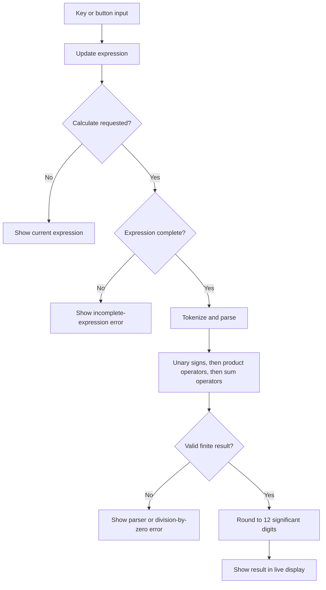

# 🧮 Calculator

A compact, responsive calculator for entering arithmetic with the keypad or keyboard. Expressions are parsed by the page's own recursive-descent parser; the implementation does not evaluate input as JavaScript.

## ✨ What it supports

- Addition (`+`), subtraction (`-`), multiplication (`*`), division (`/`), and remainder (`%`).
- Standard precedence: multiplication, division, and remainder are evaluated before addition and subtraction; operators at the same level are evaluated left to right.
- Unary plus and minus, decimal numbers, and a leading decimal point such as `.5`.
- Clear (`AC`), delete the last character (`⌫`), and a live result display.
- Incomplete input, division or remainder by zero, and invalid/non-finite results are shown as errors. Clear or enter a digit to recover from an error.

Parentheses and scientific functions are not implemented. Remainder follows JavaScript's signed remainder behavior. Displayed results are rounded to 12 significant digits.

## ⌨️ Controls

| Action | Key or button |
| --- | --- |
| Enter digits and operators | `0`–`9`, `.`, `+`, `-`, `*`, `/`, `%` or the matching on-screen keys |
| Calculate | `Enter`, `=`, or the `=` button |
| Delete last character | `Backspace` or `⌫` |
| Clear | `Escape`, `Delete`, or `AC` |

Keyboard shortcuts are handled at the document level. Buttons have accessible labels, visible keyboard focus, and the result is announced through a polite live region.

## ⚙️ Calculation flow



## 🧱 Implementation

The page is plain HTML and CSS with vanilla JavaScript. The parser tokenizes numeric literals and operators, then uses separate parsing functions for unary signs, products, and sums. There are no runtime packages, build tools, or persistence. The stylesheet requests Montserrat from Google Fonts and falls back to Arial/sans-serif.

## 📋 Prerequisites

A modern browser is required. Python 3 is optional for the local server; Node.js is optional for the syntax check.

## 🚀 Run locally

1. Open `Calculator/index.html` directly, or start a static server from the `Calculator/` directory:

   ```sh
   python -m http.server 8000
   ```

2. If using the server, open `http://localhost:8000/`.
3. To check JavaScript syntax from the repository root, run:

   ```sh
   node --check Calculator/script.js
   ```

## 🧭 Project files

```text
Calculator/
├── index.html   # Calculator structure and controls
├── style.css    # Neumorphic appearance and responsive layout
├── script.js    # Input handling and arithmetic parser
└── README.md
```

There is no committed automated interaction test. For a manual check, try `2 + 3 * 4`, `-5 % 2`, `.5 + .25`, `8 / 0`, and an incomplete expression, then verify clear, backspace, and keyboard controls.

Return to the [repository overview](../README.md).
