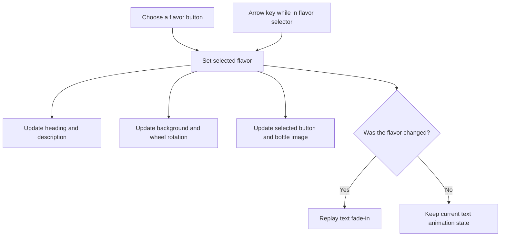

# 🍊 Fresh Press Juice Showcase

A single-page product showcase built around colorful fruit artwork and a rotating bottle carousel. Choose one of four flavors to update the product story and artwork together.

## 🍓 Flavors and interaction

The selectable flavors are **Orange**, **Plum**, **Kiwi**, and **Strawberry**. Selecting a flavor updates the heading, description, gradient background, selected thumbnail state, active bottle image, and bottle/fruit wheel rotation. The content fades in only when the selected flavor changes, so activating the already-selected flavor does not restart that text animation.



## 🧭 Navigation and responsive behavior

The Home, Flavors, About, and Explore flavors links target the existing showcase, flavor selector, or flavor description; they do not lead to separate pages. The navigation script prevents the browser's native fragment jump, focuses the relevant existing destination, and scrolls it into view. Navigation does not change the flavor or add a fragment to the address bar. The selected flavor remains selected.

The desktop layout displays a rotating carousel of bottles over fruit artwork. At widths up to 700px, the carousel shows only the selected bottle. At the same width with a viewport height up to 620px, the large decorative carousel is hidden so the flavor controls and description remain available. The thumbnails remain interactive. CSS transitions animate wheel transforms; the reduced-motion preference shortens transitions and animations.

Use a mouse, touch, `Enter`, or `Space` to activate a flavor button. With focus in the flavor selector, `ArrowLeft` and `ArrowRight` move focus and selection, wrapping between the four flavors. Navigation destinations can be reached with the standard `Tab` key. Focus indicators are visible.

## 🎨 Assets and implementation

This is static HTML, CSS, and vanilla JavaScript. There are no packages, build step, backend, or persistent state.

```text
Juice Landing page/
├── index.html
├── style.css
├── script.js
├── README.md
└── images/
    ├── logo.png
    ├── juice1.png … juice4.png
    ├── bgorange.webp, bgplumb.webp, bgkiwi.webp, bgstrawberry.webp
    └── original fruit artwork: bg*.png
```

The page loads the logo, four bottle images, and the four WebP fruit backgrounds. The original PNG fruit artwork remains in the folder but is not referenced by the page.

## 📋 Prerequisites

A modern browser is required. Python 3 is optional for serving the page locally; Node.js is optional for the syntax check.

## 🚀 Run locally

1. Open `Juice Landing page/index.html` directly, or start a static server from the `Juice Landing page/` directory:

   ```sh
   python -m http.server 8000
   ```

2. If using the server, visit `http://localhost:8000/`.
3. To check JavaScript syntax from the repository root, run:

   ```sh
   node --check "Juice Landing page/script.js"
   ```

There is no committed automated browser test. For a manual review, exercise each flavor, both arrow keys, all four navigation links, reduced-motion settings, and narrow/short as well as desktop viewports.

Return to the [repository overview](../README.md).
