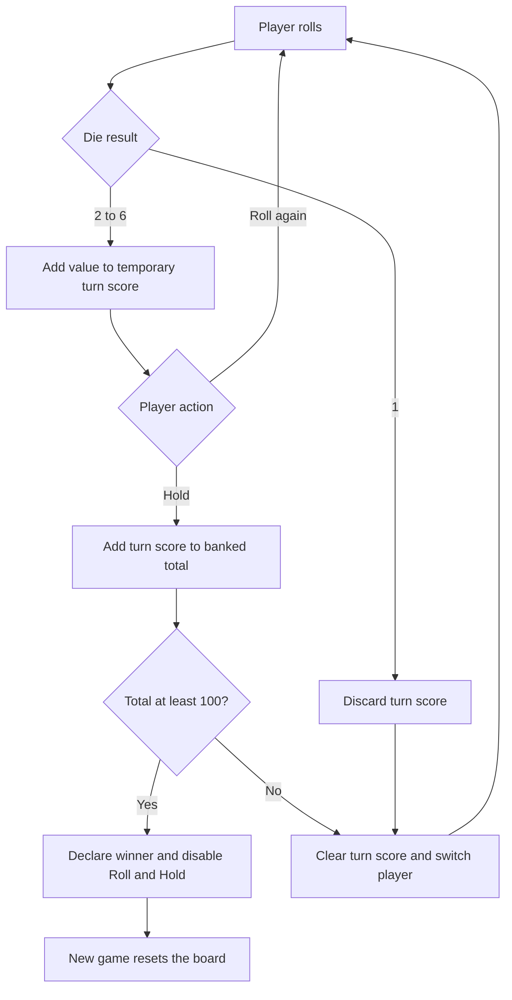

# 🎲 Pig-Game

A two-player dice game about balancing risk against the points already earned during a turn. Player 1 starts, and the first player to bank at least **100 points** wins.

## 📜 Rules

1. Select **Roll dice** to roll a randomly generated value from 1 to 6.
2. A roll from 2 to 6 adds that value to the active player's temporary turn score.
3. Select **Hold** to add the temporary turn score to the player's total and pass play to the opponent. Holding with a turn score of zero also passes the turn.
4. Rolling a 1 discards the active player's temporary turn score and passes play. The banked total is unchanged.
5. After a hold, a total of 100 or more wins. The game disables Roll and Hold until **New game** is selected.

New game resets both totals and turn scores, makes Player 1 active, hides the die, clears the winner styling, and enables the controls.

## 🔁 Turn lifecycle



## ♿ Controls and feedback

The game uses native buttons, so they can be operated by mouse, touch, or keyboard (`Tab`, `Enter`, or `Space`). The die image receives a text alternative after a roll. A polite live region announces rolls, turn changes, and wins. CSS honors reduced-motion preferences.

## 🧱 Technology and files

The game uses HTML, CSS, and vanilla JavaScript. The die roll uses `Math.random()`; there is no score persistence or backend. The stylesheet requests Nunito from Google Fonts and falls back to a local sans-serif font.

```text
Pig-Game/
├── index.html
├── style.css
├── script.js
├── .prettierrc
├── README.md
└── assets/
    ├── dice-1.png … dice-6.png
    └── pig-game-flowchart.png
```

The flowchart image is a bundled project asset; the rules above describe the current JavaScript behavior.

## 📋 Prerequisites

A modern browser is required. Python 3 is optional for the local server; Node.js is optional for the syntax check.

## 🚀 Run and check

1. Open `Pig-Game/index.html` directly, or start a static server from the `Pig-Game/` directory:

   ```sh
   python -m http.server 8000
   ```

2. If using the server, visit `http://localhost:8000/`.
3. From the repository root, run the JavaScript syntax check:

   ```sh
   node --check Pig-Game/script.js
   ```

There is no committed automated game test. Manually verify a 1, a safe roll, holding, the 100-point win, and New game. Since rolls are random, the interface does not provide a way to choose a die value.

Return to the [repository overview](../README.md).
