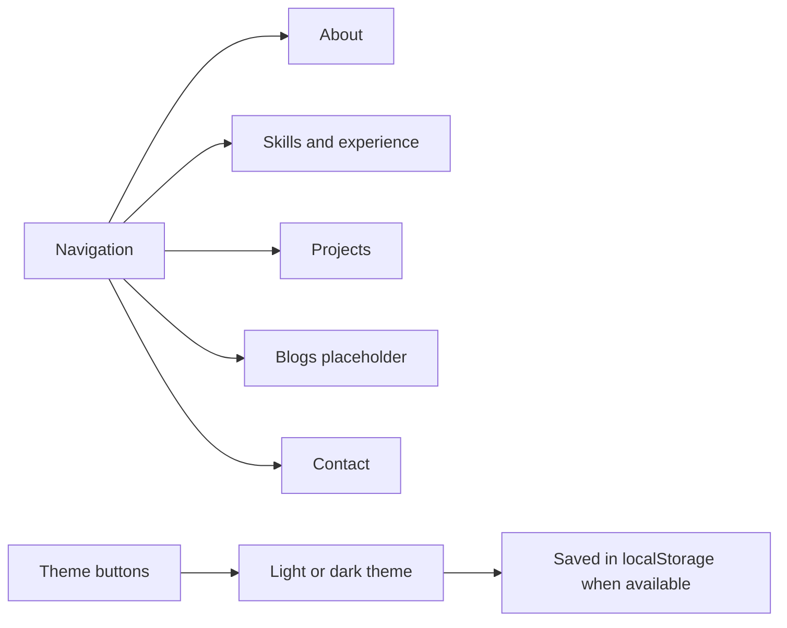

# 👋 Neeraj Mishra — Portfolio

A responsive, single-page portfolio for presenting Neeraj Mishra's profile, skills, selected projects, and contact options. Its sections are connected by in-page navigation, with desktop and mobile navigation layouts.

## 🧭 Page map



The page begins with a profile introduction, followed by About, Skills & Experience, Projects, Blogs, and Contact. The header and footer links jump to these sections. The Projects cards link to the source folders for Calculator, Juice Landing Page, Pig-Game, and To-Do Manager in the GitHub repository.

## ✨ Features

- Desktop section navigation and a mobile menu that opens from a button, closes after a section link, and closes on `Escape` with focus returned to the menu button.
- Light/dark theme buttons that stay synchronized. The choice is stored under `neeraj-portfolio-theme` in `localStorage` when browser storage is available; the theme still changes for the current visit if storage fails.
- A skip-to-content link, labeled navigation, visible focus styles, and descriptive alternative text for the profile image.
- Email (`mailto:`), telephone (`tel:`), and GitHub profile links in the contact area.
- A **Blogs** section that currently contains only “Blogs coming soon.” It has no articles, CMS, or publishing functionality.

## 🖼️ Assets and implementation

The portfolio is built with static HTML, CSS, and vanilla JavaScript. It does not use a package manager, build step, or backend. The stylesheet requests Poppins from Google Fonts and has system-font fallbacks.

The profile image uses `assets/profilephoto.webp` when supported, with `assets/profilephoto.png` as the `<picture>` fallback. Skill and contact icons are stored in `assets/` and referenced by the page. The page also includes project and contact links; it does not provide a resume download or contact form.

## 📋 Prerequisites

A modern browser is required. Python 3 is optional for serving the page locally; Node.js is optional for the syntax check. Google Fonts requires a network connection, but the stylesheet includes local fallbacks.

## 🚀 Run locally

1. From the repository root, start a static server:

   ```sh
   python -m http.server 8000
   ```

2. Open `http://localhost:8000/Portfolio/`. You can also open `Portfolio/index.html` directly.
3. Check the page script from the repository root with:

   ```sh
   node --check Portfolio/script.js
   ```

There is no committed automated Portfolio test. Manually verify section links, the mobile menu and Escape behavior, both theme buttons, and the theme behavior when storage is unavailable.

Return to the [repository overview](../README.md).
