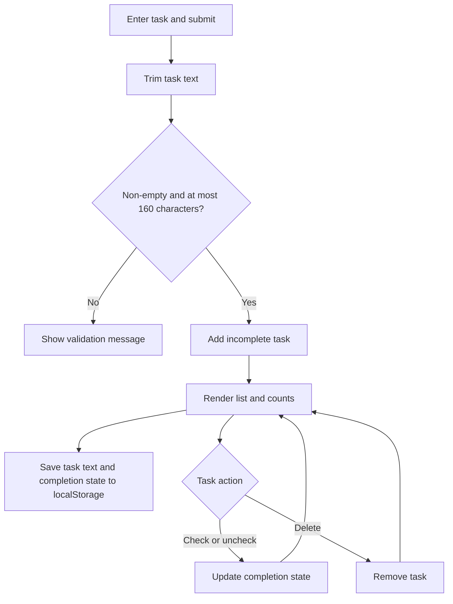

# ✅ To-Do Manager

A small task list that runs in the browser. Add a task, mark it complete or reopen it, and remove it when it is no longer needed.

## ✨ Task lifecycle



The app stores an array of `{ "text": "…", "completed": false }` records under the `todos` key in browser `localStorage`. Task IDs are created for rendering and focus management; they are not stored. The task list and status messages are rendered with DOM text nodes, so task text is displayed as text rather than interpreted as HTML.

## 🧩 Behavior and limits

- Empty or whitespace-only input is rejected. Input is trimmed and limited to 160 characters.
- Total and remaining task counts update after changes. Completed tasks can be reopened.
- Invalid JSON or unavailable/full browser storage produces a status message. If storage cannot be written, changes remain usable for the current page view but are not preserved after reload.
- Individual malformed records in a stored array are ignored while valid task records are loaded.
- There are no filters, editing, categories, due dates, sorting, accounts, or cross-device synchronization.

The interface uses a labeled task input, native checkboxes and buttons, visible focus styles, and a polite live status region. The scenic page background is `bg-image.jpg`.

## 🧱 Technology

HTML, CSS, vanilla JavaScript, and browser DOM and `localStorage` APIs. There are no packages, backend services, or build step. The stylesheet requests Poppins from Google Fonts with Arial/sans-serif fallbacks.

## 📋 Prerequisites

A modern browser is required. Python 3 is optional for local serving; Node.js is required only for the included test harness and syntax checks.

## 🚀 Run locally

1. Open `To-Do-Manager/index.html` directly, or start a static server from the `To-Do-Manager/` directory:

   ```sh
   python -m http.server 8000
   ```

2. If using the server, visit `http://localhost:8000/`.
3. Select **Add task** or press `Enter`. Use a task's checkbox to toggle completion and its Delete button to remove it.

## 🧪 Tests

From the repository root, run:

```sh
node --check To-Do-Manager/script.js
node --check To-Do-Manager/test.js
node To-Do-Manager/test.js
```

The dependency-free test harness exercises blank input, safe text rendering, adding and counting, completion and reopening, deletion, persistence across app reload, corrupt JSON recovery, and unavailable storage. It uses a small fake DOM and does not require a browser.

Return to the [repository overview](../README.md).
